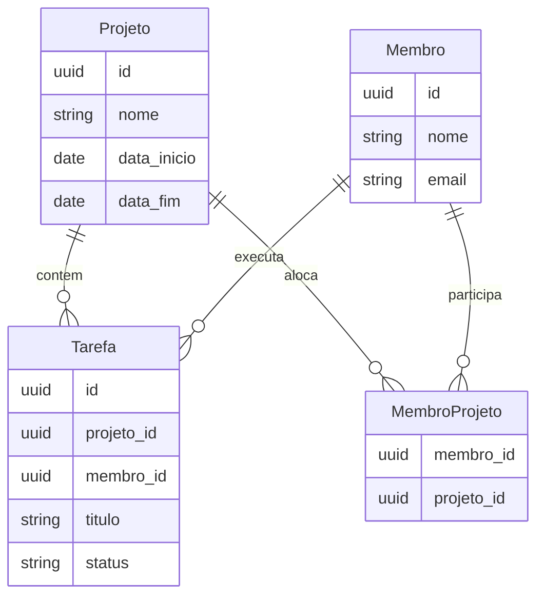

# PS Desafio 2026.2 — Sistema de Gestão de Projetos MEJ

(Laravel 11 + Next.js 14) Correções do projeto de onde foi feito Fork, modelagem de **Tarefas** e **trava de alocação**, mais documentação.

**Credenciais padrão (após seed):** `test@example.com` / `password`

**Docs interativas da API (Swagger):** [http://127.0.0.1:8000/docs/api](http://127.0.0.1:8000/docs/api)

---

## 1. Guia de Configuração e Execução

### Pré-requisitos

- PHP 8.2+, Composer, MySQL
- Node.js 20+ e [pnpm](https://pnpm.io/pt/installation)

### Clone

```bash
git clone https://github.com/ThilonM/ps-desafio-2026-2.git
cd ps-desafio-2026-2
```

### Backend (Laravel)

```bash
cd backend
composer install
cp .env.example .env
```

Edite o `.env` com as credenciais do banco (`DB_*`). Crie o schema com o nome de `DB_DATABASE`.

```bash
php artisan key:generate
php artisan storage:link
php artisan migrate --seed
# Se o banco já tiver migrations antigas:
# php artisan migrate:fresh --seed
php artisan serve
```

Backend em `http://127.0.0.1:8000`. Swagger em `http://127.0.0.1:8000/docs/api`.

### Frontend (Next.js)

```bash
cd frontend
pnpm install
cp .env.local.example .env.local
```

Confirme no `.env.local` a URL da API (ex.: `NEXT_PUBLIC_BACKEND_URL=http://127.0.0.1:8000`).

```bash
pnpm dev
```

Frontend em `http://127.0.0.1:3000`.

---

## 2. Decisões Arquiteturais e Modelagem

### Visão geral

O template já traz **Projetos** e **Membros**. Exige-se **Tarefas** vinculadas a projeto + membro, relação **N:N** projeto↔membro e a regra de **no máximo 2 projetos ativos** por membro.

### Modelagem (texto + diagrama)

```
Projeto 1──N Tarefa N──1 Membro
Projeto N──N Membro  (pivot membro_projeto)
```

| Tabela | Papel |
|---|---|
| `projetos` | Já existia (nome, datas início/fim) |
| `membros` | Já existia (nome, e-mail, etc.) |
| `membro_projeto` | Pivot N:N (FKs UUID + timestamps) |
| `tarefas` | Nova: `projeto_id`, `membro_id`, `titulo`, `descricao`, `status` + unique `(projeto_id, membro_id, titulo)` |



### Trava de alocação

Centralizada em `backend/app/Services/AlocacaoMembroService.php`:

- **Projeto ativo:** `data_inicio <= hoje` e `data_fim >= hoje`.
- Ao alocar (equipe do projeto **ou** criar tarefa que implica alocação), se o membro já tiver **2 projetos ativos** e o destino também for ativo → `ValidationException` **422** com mensagem clara.
- Projetos futuros/encerrados **não** contam no limite.
- Frontend exibe toast/alerta amigável com o erro da API.

### Front

- App Router + Server Actions no padrão do template.
- Telas `/admin/membros`, `/admin/projetos` (com diálogo de equipe), `/admin/tarefas`.
- Tailwind obrigatório; textos em PT-BR.

---

## 3. Documentação da API

Especificação OpenAPI 3: `backend/openapi.yaml`  
UI Swagger: `GET /docs/api` · Spec bruta: `GET /docs/openapi.yaml`

### Rotas principais (criadas/alteradas)

| Método | Rota | Descrição | Body / params | Resposta |
|---|---|---|---|---|
| POST | `/login` | Token Sanctum | `email`, `password` | `{ token, user }` |
| POST | `/logout` | Revoga token | — | 204 |
| GET/POST | `/membros` | Listar / criar | multipart no create | 200 / 201 / 422 |
| GET/PUT/DELETE | `/membros/{id}` | CRUD membro | multipart no update | 200 / 422 |
| GET/POST | `/projetos` | Listar / criar | JSON datas ISO | 200 / 201 / 422 |
| GET/PUT/DELETE | `/projetos/{id}` | CRUD projeto | JSON | 200 / 422 |
| GET | `/projetos/{projeto}/membros` | Equipe do projeto | — | 200 |
| POST | `/projetos/{projeto}/membros` | Alocar membro | `membro_id` | 201 / **422** (trava) |
| DELETE | `/projetos/{projeto}/membros/{membro}` | Remover da equipe | — | 204 |
| GET/POST | `/tarefas` | Listar / criar | `projeto_id`, `membro_id`, `titulo`, `descricao?`, `status?` | 200 / 201 / **422** |
| GET/PUT/DELETE | `/tarefas/{id}` | CRUD tarefa | idem | 200 / 422 |

**Formato de erro 422 (Laravel):**

```json
{
  "message": "…",
  "errors": {
    "membro_id": ["Este membro já está alocado em 2 projetos ativos…"]
  }
}
```

---

## 4. Demonstração Visual

Prints locais em [`docs/prints/`](docs/prints/) (gerados com a app rodando). Abra as imagens no repositório ou use os caminhos abaixo.

| # | Arquivo | O que mostra |
|---|---|---|
| 1 | [`docs/prints/01-swagger-openapi.png`](docs/prints/01-swagger-openapi.png) | Documentação Swagger/OpenAPI |
| 2 | [`docs/prints/02-login.png`](docs/prints/02-login.png) | Tela de login (PT-BR) |
| 3 | [`docs/prints/03-home-admin-feriados.png`](docs/prints/03-home-admin-feriados.png) | Home admin + próximos feriados (BrasilAPI) |
| 4 | [`docs/prints/04-membros.png`](docs/prints/04-membros.png) | Listagem de membros (coluna Projetos) |
| 5 | [`docs/prints/05-projetos.png`](docs/prints/05-projetos.png) | Listagem de projetos |
| 6 | [`docs/prints/06-equipe-projeto.png`](docs/prints/06-equipe-projeto.png) | Diálogo de equipe / alocação |
| 7 | [`docs/prints/07-tarefas.png`](docs/prints/07-tarefas.png) | Listagem de tarefas (ordenação) |
| 8 | [`docs/prints/08-tarefa-form.png`](docs/prints/08-tarefa-form.png) | Formulário de tarefa |
| 9 | [`docs/prints/09-validacao-trava-422.png`](docs/prints/09-validacao-trava-422.png) | Toast 422 da trava (máx. 2 projetos ativos) |

Para regenerar:

```bash
# com backend e frontend no ar
node docs/capture-prints.mjs
node docs/capture-prints-extras.mjs
node docs/capture-trava-422.mjs
```

---

## 5. Extras

| Extra | Onde verificar |
|---|---|
| **Swagger/OpenAPI** | `http://127.0.0.1:8000/docs/api` · arquivos `backend/openapi.yaml`, `backend/routes/web.php`, `backend/resources/views/swagger.blade.php` |
| **TypeScript rigoroso** | `frontend/tsconfig.json` (`strict`, `noImplicitOverride`, `noFallthroughCasesInSwitch`, `forceConsistentCasingInFileNames`, `target`) |
| **Requests / Factory / Seeder de Tarefa** | `StoreTarefaRequest`, `UpdateTarefaRequest`, `TarefaFactory`, `TarefaSeeder` |
| **API externa (BrasilAPI feriados)** | `frontend/src/services/brasil-api.ts` · card na home `/admin` |
| Localização PT-BR (labels, toasts, validação) | Telas e Form Requests |
| Ordenação de tarefas (concluídas por último → projeto → título → status → membro) | `TarefaController@index` |
| Unique título por membro+projeto | migration + rules nos Requests |
| Coluna “Projetos” na listagem de membros | UI membros + `with('projetos')` |
| Diálogo de info do membro sem input de imagem em modo leitura | componente de membros |

---

## 6. Estrutura rápida

```
backend/     API Laravel, migrations, OpenAPI, Swagger
frontend/    Next.js 14 (App Router), dashboard admin
docs/        Prints da Missão 3 + materiais de estudo
```
