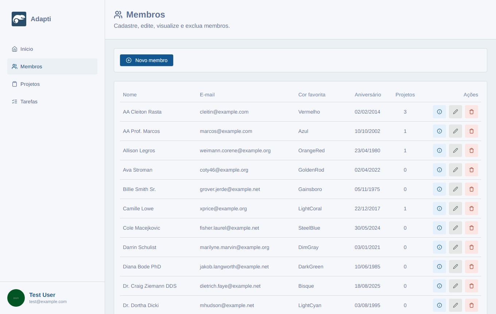
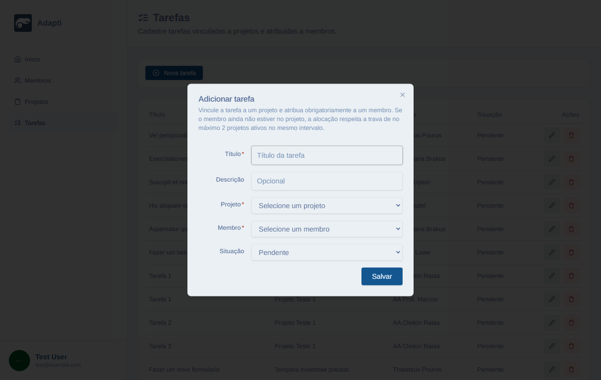
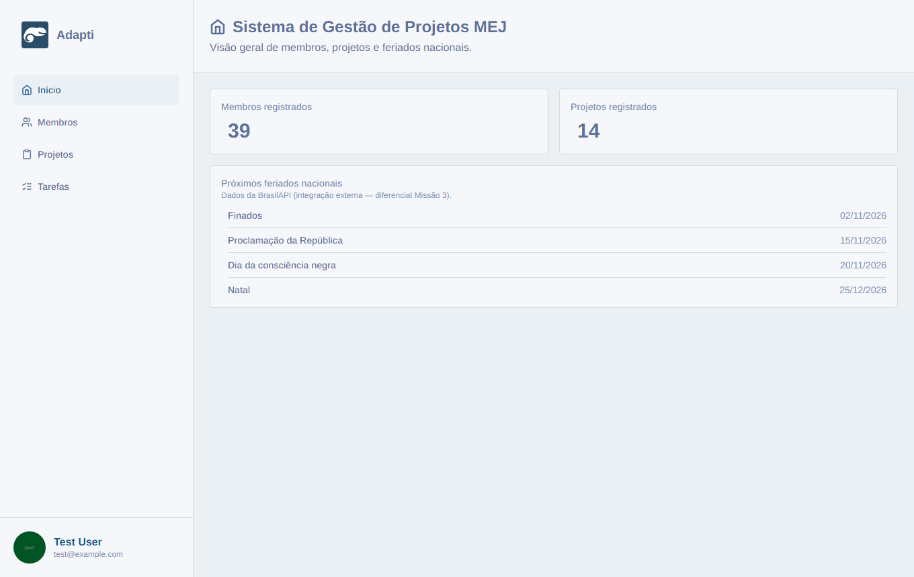

# Cola de apresentação — PS Desafio 2026.2

**Objetivo deste PDF:** você entender **absolutamente tudo** que mudou em relação ao template inicial, para apresentar amanhã com segurança.

**Login de demo:** `test@example.com` / `password`  
**Frontend:** http://127.0.0.1:3000 · **Backend:** http://127.0.0.1:8000 · **Swagger:** http://127.0.0.1:8000/docs/api

---

## Mapa mental do desafio (o que o edital pediu)

| Missão | Pedido | Status |
|---|---|---|
| **1** | Corrigir bugs do template (backend + frontend) | Feito |
| **2** | Tarefas + N:N + trava de no máx. 2 projetos ativos | Feito |
| **3** | README + prints + PR `entrega/nome-sobrenome` + Uso de IA | Feito |
| **4 (extras)** | Swagger, TS rigoroso, Requests/Factory/Seeder, API externa | Feito |

---

## Parte A — O que o template já tinha (projeto inicial)

- Laravel 11 com Sanctum, models **Projeto** e **Membro**, CRUD básico.
- Next.js 14 (App Router) com dashboard admin, login NextAuth + token da API.
- UI com Tailwind / componentes estilo shadcn.
- Seed com usuário admin `test@example.com`.

**O que faltava / estava quebrado:** validações inconsistentes, bugs de UI (mobile, datas, sidebar, Math.random), **sem** tabela de tarefas, **sem** pivot de equipe estável com regra de negócio, **sem** README de entrega.

---

## Parte B — Missão 1 (manutenção / bugs)

### Backend (ideia geral)

1. **Projetos — datas:** `data_fim` não pode ser antes de `data_inicio`; Form Requests com `authorize` e regras corretas no update.
2. **Membros — senha / e-mail:** senha no `$fillable` + hash; e-mail unique; campos nullable alinhados ao banco.
3. Mensagens de validação em português.

### Frontend (ideia geral)

1. Listagem de projetos usável no **mobile**.
2. Datas sem bug de hidratação/timezone (formato BR na UI, ISO na API).
3. Sidebar hamburger funcionando.
4. Remoção de `Math.random` que quebrava SSR/hidratação.
5. Toasts mostrando erros **422** da API.

**Como falar na banca:** “A Missão 1 foi manutenção: o template já tinha telas, mas a validação e a UX não estavam sólidas. Eu alinhei Request ↔ Model ↔ UI.”

---

## Parte C — Missão 2 (o coração do desafio)

### 1. Modelagem de dados

```
Projeto  ←——N:N——→  Membro     (tabela pivot: membro_projeto)
Projeto  1——N——→  Tarefa  ←——N——1  Membro
```

Arquivos-chave:

- Migration pivot: `backend/database/migrations/2026_10_22_210000_create_membro_projeto_table.php`
- Migration tarefas: `.../2026_10_22_210100_create_tarefas_table.php`
- Unique extra: `.../2026_10_23_212500_add_unique_tarefa_projeto_membro_titulo.php`  
  → impede o **mesmo título** para o **mesmo membro** no **mesmo projeto**.
- Models: `Tarefa.php`, relações em `Projeto.php` e `Membro.php`.

### 2. Trava de alocação (regra de negócio)

**Arquivo:** `backend/app/Services/AlocacaoMembroService.php`

- Constante: `LIMITE_PROJETOS_ATIVOS = 2`.
- **Projeto ativo** = `data_inicio <= hoje` **e** `data_fim >= hoje`.
- Se o membro já está em 2 ativos e você tenta alocar em outro ativo → **HTTP 422** com mensagem legível.
- Projetos futuros ou já encerrados **não** entram na contagem.
- Usado na **equipe do projeto** e ao **criar tarefa** (que também aloca).

**Frase pronta:** “A trava vive no Service, não espalhada no Controller, para um único lugar decidir a regra e devolver ValidationException.”

### 3. API de tarefas e equipe

- `Route::apiResource('/tarefas', …)` em `backend/routes/api.php`
- Equipe: `GET/POST /projetos/{projeto}/membros` e `DELETE .../membros/{membro}`
- Controller: `TarefaController` (listagem **ordenada**: concluídas por último → projeto → título → status → membro)
- Requests: `StoreTarefaRequest` / `UpdateTarefaRequest`
- Factory + Seeder: `TarefaFactory`, `TarefaSeeder`

### 4. Interface

- `/admin/tarefas` — CRUD completo
- `/admin/projetos` — botão/diálogo de **Equipe**
- `/admin/membros` — coluna **Projetos** + no ℹ a lista dos projetos do membro
- Avisos amigáveis quando a API devolve 422 da trava

### Prints — Missão 2 / telas novas







---

## Parte D — Missão 3 (documentação e versionamento)

### README na raiz

Arquivo: `README.md` — contém exatamente o que o edital pede:

1. Guia de configuração e execução (Laravel + Next)
2. Decisões arquiteturais e modelagem (texto + Mermaid)
3. Documentação da API (tabela de rotas + link OpenAPI)
4. Demonstração visual (prints em `docs/prints/`)
5. Extras documentados (o que não está no README **não conta**)

### Versionamento pedido

1. Trabalho no **fork** (`ThilonM/ps-desafio-2026-2`)
2. Branch de entrega: `entrega/thilon-m` (padrão `entrega/nome-sobrenome`)
3. **Pull Request** no repositório original, com seção **Uso de IA**

### Prints — Missão 3 / extras




---

## Parte E — Tópico 4 (diferenciais) — o que falar

| Extra | O que é | Onde mostrar |
|---|---|---|
| Swagger/OpenAPI | Spec YAML + UI | http://127.0.0.1:8000/docs/api |
| TypeScript rigoroso | `strict` + flags extras no `tsconfig.json` | Abrir o arquivo e citar |
| Requests/Factory/Seeder | Entidade Tarefa completa no Laravel | Pastas `Http/Requests`, `factories`, `seeders` |
| API externa | **BrasilAPI** feriados nacionais na home | Card “Próximos feriados nacionais” em `/admin` |

Código da integração:

- `frontend/src/services/brasil-api.ts` — fetch + filtro dos próximos
- `frontend/src/types/feriado.ts` — tipagem
- `frontend/src/app/(dashboard)/admin/_components/feriados-card.tsx` — UI

---

## Parte F — Extras “por conta própria” (documentados)

Além do edital, estes detalhes existem e estão no README:

1. **Ordenação inteligente de tarefas** (concluídas no fim).
2. **Unique** título + membro + projeto.
3. **PT-BR** de ponta a ponta (labels, attributes, messages).
4. **Projetos do membro** no dialog de informações + contagem na lista.
5. No dialog de info do membro, **não** mostrar seletor de imagem em modo leitura.

---

## Parte G — Roteiro de demo (10–12 min)

1. Abrir Swagger → mostrar tags Auth, Tarefas, Equipe.
2. Login → Home → apontar **feriados (BrasilAPI)**.
3. Membros → coluna Projetos → ℹ com lista.
4. Projetos → Equipe → tentar alocar membro já com 2 ativos → **toast 422**.
5. Tarefas → Nova tarefa → mostrar vínculo projeto+membro.
6. Abrir README e citar seções 2, 3, 4 e 5.
7. Se perguntarem “Ubuntu”: falar em UX (mensagem clara na trava) e DX (Service único + OpenAPI + README).

---

## Parte H — Glossário relâmpago

| Termo | Em uma frase |
|---|---|
| Eloquent | ORM do Laravel (models ↔ tabelas) |
| Pivot N:N | Tabela `membro_projeto` no meio |
| Form Request | Validação HTTP isolada do controller |
| Sanctum | Tokens de API |
| 422 | Validação falhou |
| Service | Classe só de regra de negócio |
| OpenAPI/Swagger | Contrato + UI da API |
| Eager load (`with`) | Carrega relações no mesmo SQL/request |
| `revalidatePath` | Next invalida cache da página |

---

## Parte I — Arquivos que você deve saber apontar

| Assunto | Caminho |
|---|---|
| Trava | `backend/app/Services/AlocacaoMembroService.php` |
| CRUD tarefas | `backend/app/Http/Controllers/TarefaController.php` |
| Validação tarefa | `backend/app/Http/Requests/StoreTarefaRequest.php` |
| OpenAPI | `backend/openapi.yaml` |
| Rotas Swagger | `backend/routes/web.php` |
| BrasilAPI | `frontend/src/services/brasil-api.ts` |
| Home + feriados | `frontend/src/app/(dashboard)/admin/page.tsx` |
| TS rigoroso | `frontend/tsconfig.json` |
| README entrega | `README.md` |
| Prints | `docs/prints/*.png` |

---

## Parte J — Respostas curtas se cobrarem “por quê?”

**Por que Service e não só Controller?**  
Para a mesma regra valer na equipe e na criação de tarefa, sem copiar código.

**Por que projeto “ativo” por data?**  
O edital fala em projetos ativos; a definição objetiva por intervalo de datas evita ambiguidade e dá para testar com seeds.

**Por que BrasilAPI?**  
Faz sentido num sistema de gestão (planejar sprints/entregas em torno de feriados) e é pública, sem chave.

**O que a IA fez / o que você validou?**  
(Use no PR) Ajudou em scaffolding, documentação e refactors; você revisou regra da trava, validações 422, tipagem e fluxo real no browser.

---

*Material de estudo interno. A entrega oficial no GitHub é o README + prints + código + PR com “Uso de IA”.*
